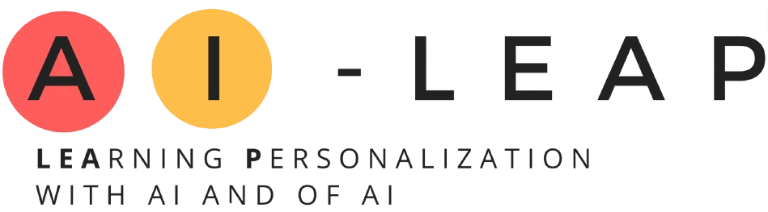

# AI-LEAP: Sistema di Digitalizzazione per Moodle

## Sommario
- [Introduzione e Contesto](#introduzione-e-contesto)
- [Struttura del Repository](#struttura-del-repository)
- [Metodologia](#metodologia)

---

## Introduzione e Contesto
Questo repository contiene la documentazione tecnica e gli elaborati del sistema di digitalizzazione per Moodle, sviluppato durante lo stage accademico presso il **Dipartimento di Informatica dell'Università degli Studi di Torino**.

Il lavoro documentato non è un'iniziativa isolata, ma si inserisce all'interno del più ampio ecosistema di **[AI-LEAP](https://ai-leap.di.unito.it/)**, un progetto accademico il cui obiettivo generale è esplorare le sfide e le opportunità dell'Intelligenza Artificiale nel contesto educativo. 

## Struttura del Repository

Il materiale è organizzato nelle seguenti directory principali per facilitarne la consultazione:

* **`docs/`**: Contiene la documentazione tecnica di sistema e le linee guida per i vari ruoli.
  > **Wiki del progetto:** È possibile consultare la documentazione completa in formato web all'indirizzo [AI-Leap WikiMoodle](https://emalter.github.io/AI-Leap_WikiMoodle/).

* **`thesis/`**: Contiene il documento della tesi di laurea in formato PDF, che descrive in dettaglio il contesto, il problema, le scelte progettuali e i risultati ottenuti.
  > **Tesi online:** La tesi è accessibile anche in [modalità libro (Documentazione)](https://emalter.github.io/AI-Leap_WikiMoodle/Documentazione/Tesi/).

## Metodologia
L'analisi e la progettazione del sistema sono state condotte seguendo la metodologia **Unified Process**, utilizzando il linguaggio di modellazione **UML** per definire i requisiti, i casi d'uso e l'architettura necessaria all'integrazione dell'applicativo con la piattaforma Moodle.