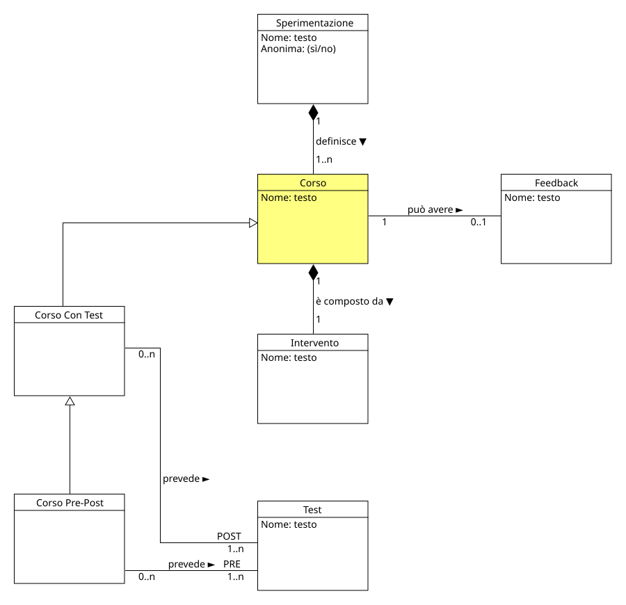

!!! info "Permessi e Ruoli"
    * **Gestisce (crea, modifica, elimina):** :material-account-hard-hat: Progettista
    * **Visualizza:** :material-account-hard-hat: Progettista, :material-shield-account: Moderatore, :material-account-tie: Esperto

Nel progetto concettuale un corso rappresenta la metodologia secondo la quale verranno eseguiti i test e presentati gli interventi. 

  

Nel modello di dominio, un corso è una classe generale che si specializza in diverse sottoclassi, ognuna delle quali rappresenta un diverso tipo di corso:

* **Corso senza Test** :material-arrow-right-thin: rappresenta un corso che non contiene test, ma soltanto un intervento (utilizzato per presentare lo studio a una classe senza somministrare test)
* **Corso con Test (solo post-test)** :material-arrow-right-thin: rappresenta un corso che contiene un intervento seguito da un test
* **Corso Pre-Post** :material-arrow-right-thin: rappresenta un corso che contiene un pre-test, un intervento e un post-test (utilizzato per valutare l'efficacia dell'intervento stesso)

## Moodle
In Moodle, esiste il concetto di Corso, ma non si allinea perfettamente con quello del progetto concettuale (già assegnato alla [Sperimentazione](experiment.md)). 
Il problema principale era identificare un oggetto/elemento di Moodle che permettesse di raggruppare più test (e interventi) pur rimanendo all'interno della stessa Sperimentazione. La soluzione è stata quella di utilizzare la **Sezione di un Corso** di Moodle. Il Progettista:material-account-hard-hat: per ogni corso che ha definito nel progetto, creerà una nuova sezione all'interno della Sperimentazione e in essa inserirà tutti i test (e interventi) che fanno parte del corso stesso.

> [!ATTENZIONE]
> Nelle sezioni successive verranno utilizzati i termini del progetto concettuale, quindi il termine **Corso** indicherà una **Sezione di un Corso** di Moodle e il termine **Sperimentazione** indicherà un **Corso** di Moodle. 
> In ogni caso, per evitare confusione, visualizzare la tabella di corrispondenza tra i termini del progetto concettuale e quelli di Moodle nella pagina [Mapping](mapping.md).

### Definire un nuovo corso
Per definire un nuovo corso è importante che il Progettista:material-account-hard-hat: sia all'interno di una [Sperimentazione](experiment.md) esistente.

I passi da seguire sono:

1. Accedere alla **Home** nel menù centrale e nella sezione **Corsi disponibili** selezionare la **Spermimentazione** nella quale si vuole creare il nuovo corso
1. In alto a destra cliccare sul pulsante **Modalità modifica**, appariranno diverse nuove "zone" modificabili all'interno della pagina
1. Cliccare in fondo alla pagina sul pulsante **Aggiungi sezione**
1. A questo punto, cliccando sul simbolo della matita **** a fianco al titolo del nuovo corso, sarà possibile modificarne il nome

### Modificare un corso 
Per definire un nuovo corso è importante che il Progettista:material-account-hard-hat: sia all'interno di una [Sperimentazione](experiment.md) esistente.

I passi da seguire sono:

1. In alto a destra, all'interno della **sperimentazione**, cliccare sul pulsante **Modalità modifica**, appariranno diverse nuove "zone" modificabili all'interno della pagina
1. Cliccare sul simbolo **** a destra del corso che si vuole modificare e nel menù che si aprirà cliccare su ** Modifica impostazioni**
1. Nella pagina che si aprirà sarà possibile modificare il nome del corso e altre impostazioni, come ad esempio la visibilità del corso stesso.
1. Cliccare sul pulsante **Salva modifiche** per salvare le modifiche effettuate.

### Eliminare un corso
Per eliminare un corso è importante che il Progettista:material-account-hard-hat: sia all'interno di una [Sperimentazione](experiment.md) esistente.

I passi da seguire sono:

1. In alto a destra, all'interno della **sperimentazione**, cliccare sul pulsante **Modalità modifica**, appariranno diverse nuove "zone" modificabili all'interno della pagina
1. Cliccare sul simbolo **** a destra del corso che si vuole modificare e nel menù che si aprirà cliccare su ** Elimina**
1. In caso di corso con elementi già presenti (come test o interventi), Moodle aprirà una finestra di conferma in cui sarà necessario confermare l'eliminazione.

### Aggiungere e rimuovere test da un corso

* Aggiungere: vedi la sezione [Creare un nuovo test](test.md#creare-un-nuovo-test)
* Rimuovere: vedi la sezione [Eliminare un test](test.md#eliminare-un-test)

### Aggiungere e rimuovere interventi da un corso

* Aggiungere: vedi la sezione [Creare un nuovo intervento](intervention.md#creare-un-nuovo-intervento)
* Rimuovere: vedi la sezione [Eliminare un intervento](intervention.md#eliminare-un-intervento)
