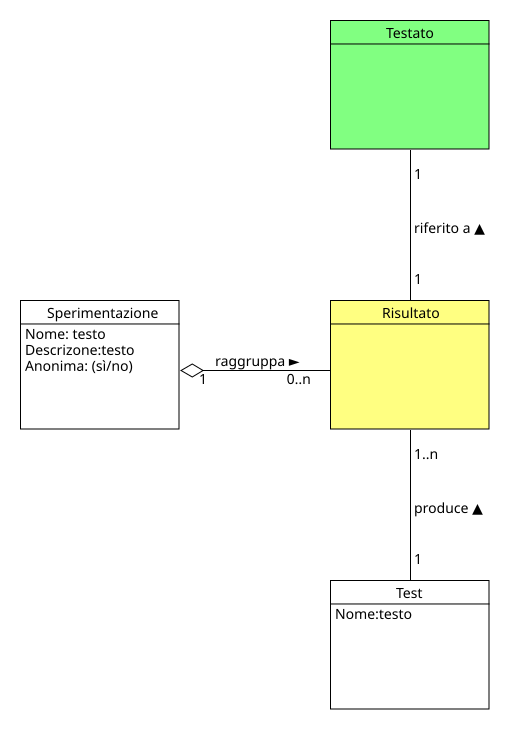

!!! info "Permessi e Ruoli"
    * **Gestisce (crea, modifica, elimina):** :material-account-hard-hat: Progettista
    * **Visualizza:** :material-account-hard-hat: Progettista

Nel progetto concettuale un risultato rappresenta l'insieme delle risposte che un testato ha fornito durante lo svolgimento di un test.

La sperimentazione aggrega i risultati che saranno poi utilizzati per l'analisi dei dati e quindi come supporto per la ricerca.

  

> [!IMPORTANTE]
> Come verranno usati i risultati non è di competenza di nessuno degli attori del progetto, l'importante è che essi vengano raccolti e resi disponibili all'esterno.

## Moodle
In Moodle, i risultati vengono raccolti attraverso il sistema di risultati di un [test](test.md) permettendo di ottenere una tabella completa con tutti i testati e le loro risposte e che può essere esportata in diversi formati (es. CSV, Excel ecc.) per poter essere analizzata successivamente.

### Visualizzare i risultati di un test
Per visualizzare i risultati di un test è importante che l'utente sia all'interno di un test esistente.

I passi da seguire sono:

1. Nel menù centrale del test, cliccare su **Risultati**
1. Nella pagina che si apre, cliccare sul menù a tendina in alto a sinistra e selezionare **Risposte dettagliate**
1. (Opzionale) è possibile filtrare i risultati per classe, cliccando sul menù a tendina a fianco di **Gruppi separati** e selezionando la [classe](class.md) desiderata
1. Nella tabella sottostante, si genereranno i risultati del test con le risposte di ogni testato, a questo punto è possibile esportare i risultati in diversi formati cliccando sul menù a tendina in alto a sinistra della tabella e premendo il bottone **Scarica**

!!! warning "ATTENZIONE"
    Non è possibile scaricare tutti i risultati dettagliati di un intero corso, ma solo dei singoli test. Per ottenere i risultati di un intero corso, sarà necessario scaricare i risultati di ogni test e unirli successivamente in un unico file (tabella dei dati).